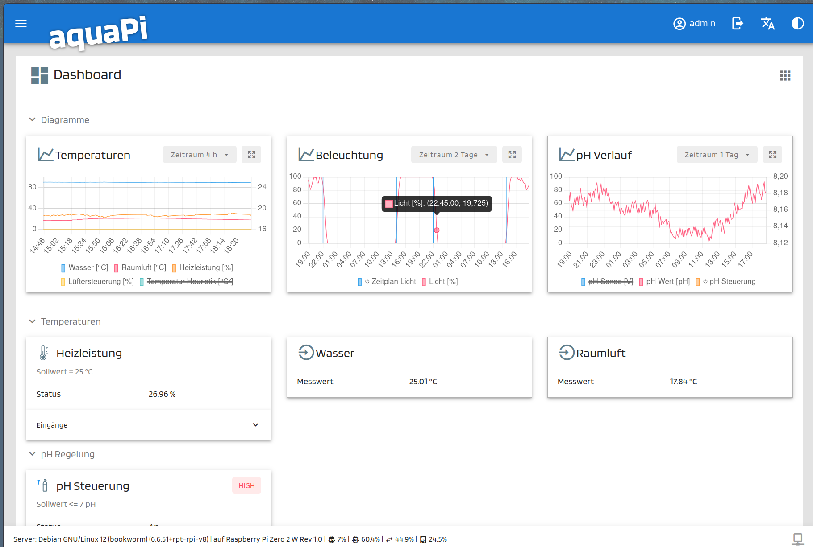

# aquaPi

*English version: [README.md](README.md)*



Eine Aquariumsteuerung für den Raspberry Pi.

aquaPi baut die Regelung deines Aquariums aus kleinen Funktionsbausteinen
zusammen. So bleibt die Hardware minimal, und die Oberfläche zeigt immer nur
das, was du tatsächlich nutzt - ob einen einzelnen Lichtdimmer oder einen
kompletten Aufbau mit redundanten Temperatursensoren, mehreren Lampen, einer
pH/CO2-Regelung und Dosierpumpen. aquaPi läuft auf einem Raspberry Pi (ein
Zero 2 W genügt) und bietet Diagramme, Alarme per E-Mail oder Telegram,
sanfte Sonnenaufgänge, Sonnenuntergänge und Wolken, mehrkanaliges Dimmen und
mehr - zu einem überschaubaren Preis.

Etwas Erfahrung mit dem Verdrahten von Hardware hilft. Wenn Elektronik nicht
dein Ding ist, kann aquaPi stattdessen einen verbreiteten TC420-LED-Controller
als Dimmer ansteuern oder die in Nordamerika verkauften Robo-Tank- und
Leviathan-Platinen nutzen - siehe
[aquaPi auf Robo-Tank / Leviathan](#aquapi-auf-robo-tank--leviathan).

**Unter der Haube** - für alle, die es genauer wissen wollen: Das Backend
ist Python / Flask, die Oberfläche Vuetify (Vue 3). Der Pi läuft ohne
Bildschirm; die Oberfläche öffnest du im Browser auf Smartphone, Tablet
oder PC.

## Installation

Auf einem Raspberry Pi mit Raspberry Pi OS **Bookworm, 64-bit** (die
getestete Basis; die Variante "Lite" genügt) und SSH-Zugang lädst du das
Installationsskript aus dem neuesten Release herunter und startest es:

```
curl -fsSL -o install.sh https://github.com/schwabix-1311/aquaPI/releases/latest/download/install.sh
bash install.sh
```

Absolutes Minimum ist ein Pi Zero W und/oder ein 32-bit Raspberry Pi OS:
Die Regelung funktioniert genauso, aber der Verlauf für die Diagramme wird
nur im Arbeitsspeicher gehalten und beginnt nach jedem Neustart leer.

Das Skript lädt das aktuelle Release herunter, richtet Python, QuestDB und
alle Abhängigkeiten ein, fragt, welche Anschlüsse des Pi eingeschaltet
werden sollen (1-Wire für DS18B20-Sensoren, I²C für einen ADS1115,
Hardware-PWM), bietet die Einrichtung von E-Mail- und Telegram-Alarmen an
und installiert aquaPi als Systemdienst, der beim Booten startet. Ist der Pi
per WLAN verbunden, richtet es zusätzlich einen Watchdog ein, der den
WLAN-Treiber neu lädt, wenn der Chip hängt - so ist der Pi nach wenigen
Minuten wieder erreichbar. Die ausführliche Anleitung Schritt für Schritt
steht in [INSTALLATION.de.md](INSTALLATION.de.md).

Danach erledigt `./manage` im Installationsverzeichnis die Wartung:
`backup`, `list-backups`, `restore`, `reconfig` (Alarmkanäle) und
`service-unit` (Systemdienst einrichten oder entfernen). Am Ende zeigt das
Skript die Adresse und das Passwort des ersten `admin`-Zugangs an.

Für ein neueres Release startest du das Skript einfach erneut und wählst
"Aktualisieren": Konfiguration, Benutzer und Sicherungen bleiben erhalten.

## Erste Schritte (der Weg für Einsteiger)

Es gibt keine fest eingebaute Verschaltung - du stellst dein Aquarium aus
fertigen Bausteinen zusammen, und der ganze Ablauf besteht aus drei Seiten.

### 1. Seite "Verschaltung" - aufbauen, dann die Hardware zuordnen

Beginne mit einer **vordefinierten Vorlage**: Wähle einen
*Temperaturregler*, eine *Licht- bzw. Sonnensteuerung*, einen
*pH/CO2-Regler* und so weiter, und jede Vorlage fügt eine komplette, bereits
verbundene Gruppe von Elementen in deine Konfiguration ein. Lösche, was du
nicht brauchst; weitere Verbindungen ziehst du später einfach vom Ausgang
eines Elements zum Eingang eines anderen.

Dann sagst du jedem Ein- und Ausgangselement, welche Hardware es benutzt.
Jedes Sensor- und Relais-Element hat eine Einstellung **Port**, deren
Auswahlliste die Ports zeigt, die aquaPi selbst auf deinem Pi gefunden hat -
GPIO-Pins, 1-Wire-Temperatursensoren, Kanäle des ADS1115-Wandlers und
Shelly-WLAN-Geräte im Netzwerk. Wähle den Port, an den du den Sensor oder
das Relais angeschlossen hast. Kein Programmcode, kein Neustart.

### 2. Seite "Parameter" - deine Werte einstellen

Solltemperatur, pH-Sollwert und Hysterese, Lichtzeiten und Dimmdauer,
Sensorkalibrierung. Mehr musst du meist nicht anfassen.

### 3. Dashboard - zusehen, wie es läuft

Ordne die Kacheln an, die dich interessieren, gruppiert und einklappbar,
mit Live-Werten und Verlaufsdiagrammen.

**Vorlagen und Sicherungen** sind zwei eigene Knöpfe auf der Seite
"Verschaltung". Eine *Sicherung* speichert deine gesamte Konfiguration,
bevor du experimentierst - falls etwas schiefgeht, stellst du sie mit einem
Klick wieder her. Eine *Vorlage* speichert eine beliebige Gruppe von
Elementen, die du aufgebaut hast, als wiederverwendbare Einheit - von
derselben Art wie die vordefinierten Vorlagen.

## So funktioniert es (für Fortgeschrittene)

Intern ist aquaPi ein Netz kleiner **Elemente**, die Nachrichten über einen
Bus austauschen. Ein minimaler Temperaturregler besteht aus drei Elementen:

1. einem **Analogeingang**, der einen Sensor liest (z.B. einen DS18B20),
2. einem **Schwellwertregler**, der um einen Sollwert ein- und ausschaltet,
3. einem **Relaisausgang**, der einen Heizstab schaltet.

Fügst du ein **Verlaufselement** hinzu, bekommst du Temperaturdiagramme mit
wählbarem Zeitraum. Für Redundanz ergänzt du später einen zweiten Eingang
für einen weiteren Sensor plus ein **Mittelwertelement** und lässt den
Schwellwertregler den Mittelwert statt eines einzelnen Sensors verwenden -
sonst ändert sich nichts.

Weil die Elemente Nachrichten über einen gemeinsamen Bus austauschen statt
fest miteinander verdrahtet zu sein, kann derselbe Messwert genauso leicht
mehrere unabhängige Regelkreise gleichzeitig versorgen - z.B. ein
Temperatursensor sowohl den Schwellwertregler der Heizung als auch eine
eigene Übertemperatur-Regelung für Lüfter oder Licht -, wieder ohne
zusätzliche Hardware oder doppelt eingerichtete Sensoren. Nach demselben
Baukastenprinzip lassen sich mehrere Regler mit gemeinsamen Ausgängen,
pH-abhängiges Licht und vieles mehr aufbauen.

## Keine Cloud, kein Nach-Hause-Telefonieren

aquaPi ist nicht cloudbasiert und hängt von keinem externen Dienst ab. WLAN
wird nur gebraucht, damit Smartphone oder PC die Oberfläche erreichen; dieser
Verkehr bleibt in deinem Heimnetz, außer *du* machst ihn bewusst von außen
erreichbar (VPN oder ähnlich).

Mit Internetzugang bekommst du die automatische Uhrzeitkorrektur und die
Möglichkeit, Alarme und Erinnerungen per E-Mail oder Telegram zu versenden -
und sonst nichts. Kein versteckter Datenverkehr, keine Telemetrie, kein
Benutzerkonto irgendwo.

## aquaPi auf Robo-Tank / Leviathan

aquaPi läuft auf einem Robo-Tank-v3-Controller, so wie er ist: Behalte
Module, Kabel und Steckdosenleisten, installiere aquaPi statt reef-pi und
wähle die Ports auf der Seite "Verschaltung". Die Anschlüsse der Platine
entsprechen diesen Ports:

```
Robo-Tank v3                  aquaPi-Port
DC-Port, RJ45-Pins 2..8       PCA9685 #1 CH9, CH6, CH7, CH4, CH3, CH2, CH1  (als "... PWM")
LED-Port, RJ45-Pins 2..8      PCA9685 #1 CH15, CH14, CH13, CH12, CH11, CH10, CH8  (als "... PWM")
Futterautomat (Feeder)        PCA9685 #1 CH0 out
Steckdosenleiste 1, 1..8      GPIO 21, 20, 16, 6, 12, 13, 19, 26 out
Steckdosenleiste 2, 1..8      GPIO 5, 11, 9, 10, 24, 25, 8, 7 out
Sensor 1..6                   GPIO 14, 15, 17, 18, 27, 23 in
Temp 1                        DS1820-Sensoren an GPIO 4 (1-Wire)
Temp 2                        DS1820-Sensoren an GPIO 22 (1-Wire, siehe unten)
```

Jeder PCA9685-Kanal wird doppelt angeboten: als Dimmer ("... PWM") und als
Ein/Aus-Ausgang ("... out"); wird der eine benutzt, verschwindet der andere.

Ein paar Einstellungen nimmt dir das Installationsskript nicht ab:

1. Beantworte die Frage nach Hardware-PWM mit **nein**: Auf einem
   Robo-Tank ist GPIO 18 ein Sensoreingang und GPIO 19 eine Steckdose.
2. **Temp 2** braucht einen zweiten 1-Wire-Bus: Füge die Zeile
   `dtoverlay=w1-gpio,gpiopin=22` in `/boot/firmware/config.txt` ein und
   starte neu. aquaPi zeigt dann auch diese Sensoren an und hält GPIO 22
   für den 1-Wire-Bus reserviert.
3. **Sensor 1 und 2** liegen auf den seriellen Pins (GPIO 14/15): In
   `sudo raspi-config` -> Interface Options -> Serial Port die Login-Shell
   mit "No" und die serielle Hardware mit "No" beantworten, dann neu
   starten.
4. Lass SPI ausgeschaltet (die Voreinstellung): Steckdosenleiste 2 benutzt
   diese Pins.

Noch nicht unterstützt: die galvanisch getrennte pH-Schaltung des Robo-Tank
und Platinenbeschriftungen in der Portauswahl (sie zeigt "PCA9685 #1 CH9
PWM", nicht "DC 1"). Für Leviathan-Platinen gibt es keine veröffentlichte
Pinbelegung; ihre Steckdosen sind einfache GPIOs und ihre Lampen
PCA9685-Kanäle, sie sollten also genauso funktionieren - die Zuordnung muss
man von Hand herausfinden.

## Was heute funktioniert

- **Konfiguration über die Oberfläche.** Vordefinierte Vorlagen fügen
  komplette Regelungen ein; die Seite "Verschaltung" legt Elemente an,
  verbindet, bearbeitet und löscht sie; die Seite "Parameter" stellt sie
  ein; Sicherungen speichern eine ganze Konfiguration und stellen sie wieder
  her. Für den normalen Betrieb muss kein Python-Code bearbeitet werden.
- **Regelbausteine** für Temperatur, pH/CO2 und Licht, darunter sanfte
  Simulation von Sonnenaufgang, Sonnenuntergang und Wolken, PID-Heizung,
  Min/Max-Schwellwerte, Dimm- und Zeitplan-Eingänge, Mittelwert- und
  Skalierungsbausteine.
- **Sensorkalibrierung** mit einem 2-Punkt-Assistenten (z.B. pH-Pufferlösung
  7 und 4), der den aktuellen Sensorwert liest, plus Kalibrierverlauf.
- **Verlauf & Diagramme** mit QuestDB (64-bit Pi) und einer Variante im
  Arbeitsspeicher für 32-bit-Systeme, wählbarer Zeitraum und
  Tagesmittelwert-Ansicht.
- **Dashboard** mit gruppierten, einklappbaren Abschnitten und frei
  anordenbaren Kacheln, dazu Kacheln zum direkten Schalten, Schieben und
  Eingeben von Werten.
- **Alarme** per E-Mail und Telegram, mit Schwellwerten und Dauer je
  Bedingung, einem Eskalationskanal nach einstellbarer Verzögerung und einer
  Benachrichtigung beim Start, falls ein Element nicht geladen werden kann.
  Nachrichten nennen den sendenden Rechner.
- **Treiber**: GPIO-Ein- und -Ausgänge, Onboard-PWM, TC420, DS18B20
  (1-Wire), ADS1115-Wandler (pH-Sonde), PCA9685-PWM-Erweiterung (jeder Kanal
  als Dimmer oder Ein/Aus-Ausgang) und Shelly-WLAN-Geräte - Relais, Dimmer
  und als Schalter konfigurierte Eingänge (Taster werden noch nicht
  unterstützt), automatisch per mDNS gefunden, Gen1 und Gen2.
- **Benutzer & Zugriff** mit den Rollen viewer, operator und admin,
  automatisch erzeugten Passphrasen für neue Zugänge und einer anonymen
  Nur-Lese-Ansicht.
- **Automatische tägliche Sicherung** der Konfigurations- und
  Benutzerdatenbanken in rotierende Archive, plus Download einer Sicherung
  auf Knopfdruck in der Oberfläche. Für Überwachung gibt es außerdem den
  Endpunkt `/api/health` ohne Anmeldung.
- **Installationsskript und Wartungsbefehl**: `install.sh` richtet einen Pi
  aus einem Release ein, `./manage` sichert, stellt wieder her und
  konfiguriert neu. Die Seite "Über aquaPi" zeigt die installierte Version.
- Alle Treiber haben einen **Simulationsmodus**, sodass das ganze System auf
  einem normalen Linux-PC läuft, ohne Raspberry Pi und ohne angeschlossene
  Sensoren.

## Was als Nächstes kommt

- Weitere Treiber: zusätzliche I²C-Chips, weitere WLAN-Geräte, ein
  Shelly-Temperatur-Add-on.
- Eine Seite mit Protokoll / Ereignissen in der Oberfläche.
- Eine Seite für Systemeinstellungen in der Oberfläche (Treiberkonten,
  Geräte-Sperrliste).
- Interruptgesteuerte Eingänge.
- Dokumentation, mehr Tests, mehr Übersetzungen, ein englisches
  Installationsskript.

## Feedback und Hilfe

Fragen, Ideen und Fehlerberichte sind auf GitHub in den
[Discussions](https://github.com/schwabix-1311/aquaPI/discussions) und
[Issues](https://github.com/schwabix-1311/aquaPI/issues) willkommen - auf
Deutsch oder Englisch.

Markus Kuhn, 2024-12-21 · neu geschrieben 2026-09 · aktualisiert 2026-11
