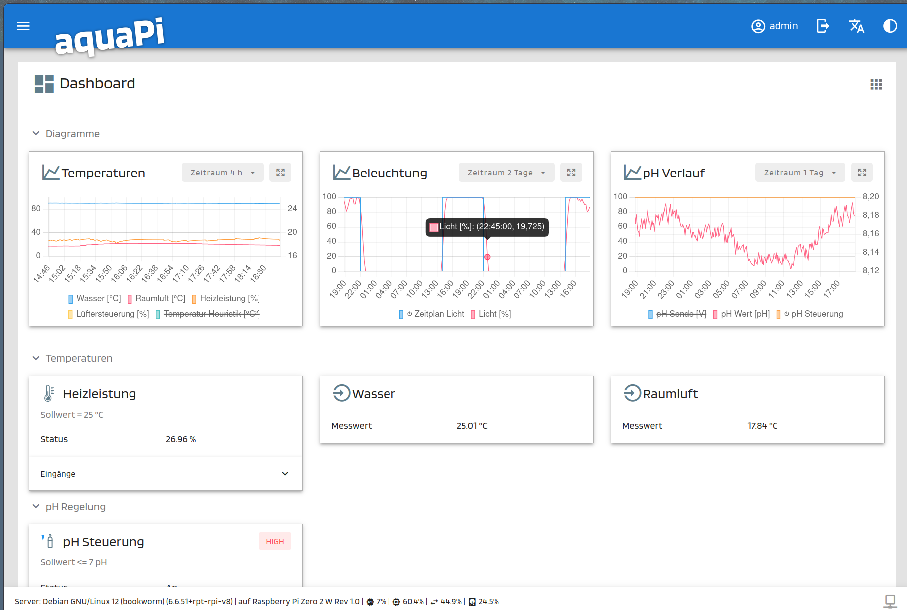

# aquaPi

*Deutsche Version: [README.de.md](README.de.md)*



A fish-tank controller for the Raspberry Pi.

aquaPi builds the control logic for your tank from small functional blocks, so
the hardware stays minimal and the user interface only ever shows what you
actually use — whether that is a single light dimmer or a full setup with
redundant temperature sensors, several lights, a pH/CO2 controller and dosing
pumps. It runs on a Raspberry Pi (a Zero 2 W is enough) and gives you charts,
email or Telegram alerts, smooth sunrise/sunset/cloud lighting, multi-channel
dimming and more, for a modest price.

Some experience with hardware wiring helps. If electronics are not your thing,
aquaPi can instead drive a common TC420 LED controller as its dimmer, or the
Robo-Tank / Leviathan boards sold in North America - see
[Running aquaPi on Robo-Tank / Leviathan](#running-aquapi-on-robo-tank--leviathan).

**Under the hood** — for anyone who wants to understand it or contribute: the
backend is Python / Flask, the frontend is Vuetify (Vue 3). The Pi runs
headless; you open the interface in a browser on your phone, tablet or PC.

## Installation

> **Release 1.0 is coming soon.** Until it is published, the installer below
> has nothing to download yet. To try aquaPi now, use a git checkout as
> described under [Contributing](#contributing).

On a Raspberry Pi with Raspberry Pi OS **Bookworm, 64-bit** (the tested base;
Lite is enough) and SSH access, download the installer from the latest release
and run it:

```
curl -fsSL -o install.sh https://github.com/schwabix-1311/aquaPI/releases/latest/download/install.sh
bash install.sh
```

The absolute minimum is a Pi Zero W and/or a 32-bit Raspberry Pi OS: control
works the same, but chart history is kept in memory only and starts empty
after every restart.

The installer downloads the current release, sets up Python, QuestDB and all
dependencies, asks which Pi interfaces to switch on (1-Wire for DS18B20
sensors, I²C for an ADS1115, hardware PWM), offers to configure
email/Telegram alerts, and installs aquaPi as a system service that starts
on boot. On a Pi connected via WiFi it also sets up a watchdog that reloads
the WiFi driver when the chip hangs, so the Pi becomes reachable again
within minutes. The step-by-step guide is
[INSTALLATION.md](INSTALLATION.md) ([deutsch](INSTALLATION.de.md)); the
installer asks for English or German first.

Afterwards `./manage` in the install directory handles maintenance:
`backup`, `list-backups`, `restore`, `reconfig` (alert channels) and
`service-unit` (install/remove the system service). At the end the installer
shows the address and the password of the initial `admin` account.

To update to a newer release, run the installer again and choose
"Update": configuration, users and backups are kept.

## Getting started (the beginner's way)

There is no fixed built-in wiring — you assemble your tank from ready-made
building blocks, and the whole flow is three pages.

### 1. Wiring page — build it, then connect your hardware

Start from a **predefined template**: pick a *temperature controller*, a
*sun/light controller*, a *pH/CO2 controller* and so on, and each one drops
a complete, pre-connected group of blocks into your configuration. Delete
anything you don't need; add more later by dragging from one block's output
to another block's input.

Then tell each input and output block which piece of hardware it uses.
Every sensor and relay block has a **port** setting, and its dropdown lists
the ports aquaPi discovered on your Pi by itself — GPIO pins, 1-Wire
temperature sensors, ADS1115 ADC channels, and Shelly WiFi devices found
over the network. Select the port you wired that sensor or relay to. No
source editing, no restart.

### 2. Parameters page — set your values

Target temperature, pH setpoint and hysteresis, light schedule and fade
times, sensor calibration. That's usually all you need to touch.

### 3. Dashboard — watch it run

Arrange the tiles you care about, grouped and collapsible, with live values
and history charts.

**Templates and Snapshots** are two separate buttons on the Wiring page.
A *Snapshot* saves your whole configuration before you experiment, to
restore in one click if something goes wrong. A *Template* saves any group
of blocks you built as a reusable unit — the same kind the predefined
templates are.

## How it works (the advanced view)

Internally aquaPi is a graph of small **nodes** exchanging messages on a bus.
A minimal temperature controller is three nodes:

1. an **analog input** node reading a sensor (e.g. a DS18B20),
2. a **threshold** controller node that switches on/off around a setpoint,
3. a **relay output** node driving a heater.

Add a **history** node and you get temperature graphs with a selectable
period. For redundancy later, add a second input node for another sensor plus
an **averaging** node, and point the threshold node at the average instead of
a single sensor — no other change needed.

Because nodes exchange messages on a shared bus rather than being wired
point-to-point, the same sensor reading can just as easily feed several
independent controller loops at once — e.g. one temperature sensor driving
both the heater's threshold controller and a separate over-temperature
fan/dimming controller — again with no extra hardware or duplicate sensor
config. The same building-block approach scales up to several controllers
sharing outputs, pH-triggered lighting, and so on.

## No cloud, no calling home

aquaPi is not cloud-based and does not depend on any external service. WiFi is
needed only so your phone or PC can reach the interface; that traffic stays on
your local network unless *you* choose to expose it (VPN or similar).

Give it internet access and you gain automatic clock correction and the
ability to send alerts and reminders to email or Telegram — and nothing else.
No hidden data traffic, no telemetry, no account anywhere.

## Running aquaPi on Robo-Tank / Leviathan

aquaPi runs on a Robo-Tank v3 controller as it is: keep your modules,
cables and power bars, install aquaPi instead of reef-pi, and pick the
ports in the Wiring editor. The board's peripherals map to these ports:

```
Robo-Tank v3              aquaPi port
DC port, RJ45 pins 2..8   PCA9685 #1 CH9, CH6, CH7, CH4, CH3, CH2, CH1  (as "... PWM")
LED port, RJ45 pins 2..8  PCA9685 #1 CH15, CH14, CH13, CH12, CH11, CH10, CH8  (as "... PWM")
Feeder                    PCA9685 #1 CH0 out
Power bar 1, outlet 1..8  GPIO 21, 20, 16, 6, 12, 13, 19, 26 out
Power bar 2, outlet 1..8  GPIO 5, 11, 9, 10, 24, 25, 8, 7 out
Sensor 1..6               GPIO 14, 15, 17, 18, 27, 23 in
Temp 1                    DS1820 sensors on GPIO 4 (1-Wire)
Temp 2                    DS1820 sensors on GPIO 22 (1-Wire, see below)
```

Each PCA9685 channel is offered twice: as a dimmer ("... PWM") and as an
on/off output ("... out"); using one hides the other.

A few settings the installer doesn't make for you:

1. Answer **no** to the installer's hardware-PWM question: on a Robo-Tank,
   GPIO 18 is a sensor input and GPIO 19 a power-bar outlet.
2. **Temp 2** needs a second 1-Wire bus: add the line
   `dtoverlay=w1-gpio,gpiopin=22` to `/boot/firmware/config.txt` and
   reboot. aquaPi then lists those sensors too and keeps GPIO 22
   reserved for the 1-Wire bus.
3. **Sensors 1 and 2** sit on the serial pins (GPIO 14/15): in
   `sudo raspi-config` -> Interface Options -> Serial Port, answer "No"
   to the login shell and "No" to the serial hardware, then reboot.
4. Keep SPI switched off (the default): power bar 2 uses its pins.

Not supported yet: Robo-Tank's isolated pH circuit, and board labels in
the port picker (it shows "PCA9685 #1 CH9 PWM", not "DC 1"). Leviathan
boards have no published pinout; their outlets are plain GPIOs and their
lights PCA9685 channels, so they should work the same way, with the
mapping found by hand.

## What works today

- **Configuration through the UI.** Predefined templates drop in complete
  controller setups; the Wiring editor creates, connects, edits and deletes
  nodes; the Parameters page tunes them; Snapshots save and restore a whole
  configuration. No Python editing needed for normal use.
- **Control blocks** for temperature, pH/CO2 and light, including smooth
  sunrise / sunset / cloud simulation, PID heating, min/max thresholds,
  fade and schedule inputs, averaging and scaling blocks.
- **Sensor calibration** with a 2-point helper (e.g. pH buffers 7 and 4)
  that reads the live sensor value, plus a calibration history.
- **History & charts** backed by QuestDB (64-bit Pi) with an in-memory
  fallback for 32-bit systems, selectable time span and daily-average view.
- **Dashboard** with grouped, collapsible sections and user-arrangeable
  tiles, plus direct switch/slider/value control tiles.
- **Alerts** via email and Telegram, with per-condition thresholds and
  durations, an escalation channel after a configurable delay, and a
  startup notification if a node fails to load. Messages are tagged with the
  sending host.
- **Drivers**: GPIO in/out, on-board PWM, TC420, DS18B20 (1-Wire),
  ADS1115 ADC (pH probe), PCA9685 PWM expander (each channel as dimmer or
  on/off output), and WiFi Shelly devices — relays, dimmers and
  inputs set to switch mode (momentary buttons are not supported yet),
  auto-discovered via mDNS, Gen1 and Gen2.
- **Users & access** with viewer / operator / admin roles, auto-generated
  passphrases for new accounts, and an anonymous read-only view.
- **Automatic daily backup** of the configuration and user databases into
  rotating archives, plus an on-demand backup download from the UI. There
  is also an unauthenticated `/api/health` endpoint for monitoring.
- **Installer and maintenance CLI**: `install.sh` sets up a Pi from a
  release, `./manage` backs up, restores and reconfigures it. The About page
  shows the installed version.
- All drivers have a **simulation mode**, so the whole system runs on a
  plain Linux PC with no Raspberry Pi and no sensors attached.

## What's next

- More drivers: additional I²C chips, further WiFi devices, a Shelly
  temperature add-on.
- A log / events page in the UI.
- A system settings page in the UI (driver accounts, device blacklist).
- Interrupt-driven inputs.
- Documentation, more tests, more translations.

## Running the automated tests

The backend test suite (`tests/`) uses `pytest`, needs no real hardware and no
manual setup — almost every test builds its own temporary, isolated SQLite
database and a simulation-mode node bus, with no QuestDB required. From the
project root, with your virtual environment active:

```
pip install -r requirements-dev.txt
pytest
```

For faster local runs, `pytest -n auto` spreads the suite across all CPU cores
(~4x faster; every test gets its own isolated `tmp_path`, and the single test
that touches QuestDB is self-contained via a uniquely-named throwaway node
id). A `questdb` marker tags the (currently one) test that needs a real,
reachable QuestDB — exclude it with `pytest -m "not questdb"` (as CI does,
since it has none).

The SPA's pure helper modules (the `/wiring` canvas layout algorithm,
draft diffing, connection/port-picker rules, the record-list widget's row
helpers, ...) have JavaScript unit tests under `tests/js/`, run with
Node's built-in test runner — no `npm install`, no build step, and run in
CI alongside `pytest`:

```
node --test "tests/js/**/*.test.js"
```

## Contributing

Contributions of any kind are welcome — please leave a note in Discussions or
Issues. If you just have a "killer feature" idea, Discussions is the place for
that too. German is my native language, so feel free to use it there.

To try aquaPi, clone the repository to e.g. `~/aquaPI` on a Raspberry Pi or
any Linux machine, then run `. aquaPI/init`. That sets up Python and all
dependencies and explains how to start the development instance.

The target platform is Raspberry Pi OS (64- or 32-bit); development works on
any Linux system with Python 3.10 or newer. Windows may work as a dev
environment, but is not tested.

A git checkout also contains `tools/pid-autotune`, which profiles a tank and
tunes a PID heater's gains against a running aquaPi without ever taking the
controller out of the loop (`tools/pid-autotune --help`). It is not part of
the release bundle.

Markus Kuhn, 2024-12-21 · rewritten 2026-09 · updated 2026-11
